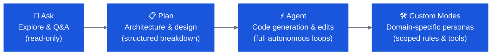

# IBM Bob — STU FEI Lecture

Welcome to the **IBM Bob Hands-On Lecture** at STU FEI! This is your complete guide — choose a track, follow the step-by-step instructions, and build real applications with IBM Bob.

## Lecture format (90 minutes)

| Part | Time | What happens |
|---|---|---|
| Lecture | ~30 min | Introduction to IBM Bob |
| Hands-on part (optional) | ~60 min | We start together with the first lab of the 🟢 Beginner track. You can continue with the rest at your own pace — questions are welcome. |
| Afterwards (optional) | on your own | You can finish the remaining labs at home. |

---

## Choose Your Track

-   :material-numeric-1-circle:{ .lg .middle } __[🟢 Beginner](labs/beginner.md)__

    ---

    **3 labs · No prior Bob experience needed**

    Build a confetti welcome app, add layover support to a full-stack travel app, then wire up date pickers and a mock AI booking agent — touching **Ask**, **Plan**, and **Agent** modes throughout.

    [:octicons-arrow-right-24: Start Beginner Track](labs/beginner.md)

-   :material-numeric-2-circle:{ .lg .middle } __[🟡 Intermediate](labs/intermediate.md)__

    ---

    **2 labs · Basic Bob familiarity assumed**

    Drive a full **Issue → Branch → Code → PR** loop with GitHub MCP, then author and commit version-controlled team rules that Bob applies automatically on every interaction.

    [:octicons-arrow-right-24: Start Intermediate Track](labs/intermediate.md)

-   :material-numeric-3-circle:{ .lg .middle } __[🔴 Expert](labs/expert.md)__

    ---

    **4 labs · For power users and architects**

    Discover a banking-industry codebase, build a React UI, run a security audit, author fintech compliance rules, create a custom scoped mode, and automate the full SDLC with GitHub MCP.

    [:octicons-arrow-right-24: Start Expert Track](labs/expert.md)

-   :material-trophy:{ .lg .middle } __[🏆 Challenge](labs/challenge.md)__

    ---

    **Open build · Optional · Self-paced, at home**

    Build **PocketLedger** — a full-stack personal finance tracker — using every Bob skill you've learned: `/init`, rules, a custom mode, and a complete GitHub issue-to-PR loop.

    [:octicons-arrow-right-24: Take the Challenge](labs/challenge.md)

---

## Bob Modes at a Glance

---

## Resources

| | Link |
|---|---|
| **IBM Bob** | [bob.ibm.com](https://bob.ibm.com) |
| **Documentation** | [ibm.biz/bob-doc](https://ibm.biz/bob-doc) |
| **Blog** | [bob.ibm.com/blog/getting-the-most-out-of-bob](https://bob.ibm.com/blog/getting-the-most-out-of-bob) |
| **IBMid sign-up** | [ibm.com/account/reg](https://www.ibm.com/account/reg/us-en/signup?formid=urx-19776) |
