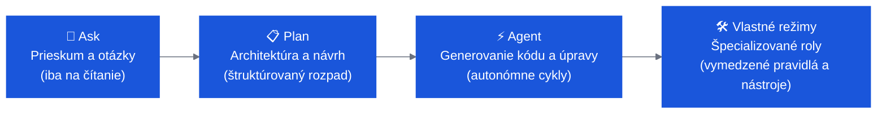

# IBM Bob — Prednáška na STU FEI

Vitajte na praktickej prednáške **IBM Bob** na STU FEI! Toto je váš kompletný sprievodca — vyberte si úroveň, postupujte podľa podrobných inštrukcií a vytvorte reálne aplikácie s pomocou IBM Bob.

## Priebeh prednášky (90 minút)

| Časť | Čo sa deje |
|---|---|
| Prednáška | Úvod do IBM Bob |
| Praktické cvičenie (voliteľné) | Vyučujúci vyberie jeden lab z úrovní nižšie a prejde ho spoločne s poslucháčmi, pričom priebežne odpovedá na otázky. |
| Potom (voliteľné) | Pokračujte ďalšími labmi doma vlastným tempom. |

---

## Vyberte si úroveň

-   :material-numeric-1-circle:{ .lg .middle } __🟢 Začiatočník__

    ---

    **3 laby · Nevyžadujú sa predchádzajúce skúsenosti s Bobom**

    Vytvorte aplikáciu s konfetami, pridajte podporu medzipristátí do full-stack cestovnej aplikácie a integrujte výber dátumov spolu s mock AI rezervačným agentom — vyskúšate si režimy **Ask**, **Plan** a **Agent**.

-   :material-numeric-2-circle:{ .lg .middle } __🟡 Pokročilý__

    ---

    **2 laby · Predpokladá sa základná znalosť Boba**

    Prejdite si kompletný cyklus **Issue → Vetva → Kód → PR** pomocou GitHub MCP, potom vytvorte a commitnite verzované tímové pravidlá, ktoré Bob automaticky uplatňuje pri každej interakcii.

-   :material-numeric-3-circle:{ .lg .middle } __🔴 Expert__

    ---

    **4 laby · Pre pokročilých používateľov a architektov**

    Preskúmajte kódovú bázu bankového systému, vytvorte React UI, vykonajte bezpečnostný audit, napíšte pravidlá pre fintech compliance, vytvorte vlastný špecializovaný režim a automatizujte celý SDLC cez GitHub MCP.

-   :material-trophy:{ .lg .middle } __🏆 Výzva__

    ---

    **Otvorený vývoj · Voliteľné · Vlastným tempom, doma**

    Vytvorte **PocketLedger** — full-stack aplikáciu na sledovanie osobných financií — s využitím všetkých schopností Boba, ktoré ste sa naučili: `/init`, pravidlá, vlastný režim a kompletný GitHub issue-to-PR cyklus. Nikto ho nehodnotí; použite zabudovaný zoznam na samokontrolu.

!!! info "Laby budú dostupné počas prednášky"

---

## Režimy IBM Bob v skratke

---

## Užitočné odkazy

| | Odkaz |
|---|---|
| **IBM Bob** | [bob.ibm.com](https://bob.ibm.com) |
| **Dokumentácia** | [ibm.biz/bob-doc](https://ibm.biz/bob-doc) |
| **Blog** | [bob.ibm.com/blog/getting-the-most-out-of-bob](https://bob.ibm.com/blog/getting-the-most-out-of-bob) |
| **Registrácia IBMid** | [ibm.com/account/reg](https://www.ibm.com/account/reg/us-en/signup?formid=urx-19776) |
